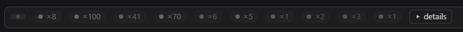
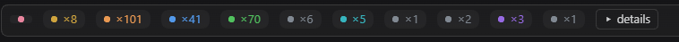
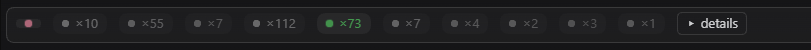
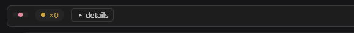
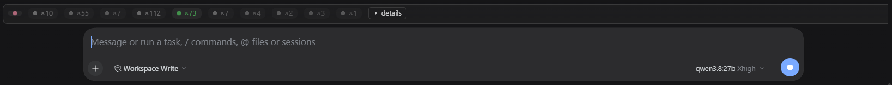
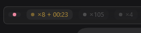
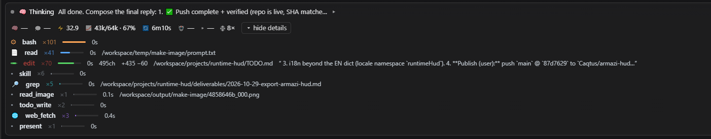

# armazi-hud

A live status strip (HUD) for the DeepSeek Harness (DSH) web GUI.
It sits in the conversation dock and renders **existing** session state —
thinking, tool activity, runtime metrics, todos, compaction — as a compact
collapsible strip. It changes nothing about the model: **no prompts, no new
tools, zero dependencies, zero LLM cost.**

By [Caqtus](https://github.com/Caqtus) · MIT · DSH 0.2.x (web platform)

## What it does

Armazi-hud gives you a constant, at-a-glance readout of what the session is
doing — and how it's costing in time and context — without asking the model
for anything. The strip has two states: a one-line summary by default, and a
full detail view one click away.

## Where it lives

In the DSH **web GUI**, the HUD renders inside the conversation pane, in the
reserved dock strip **right above the message input box**. It takes exactly
one slot (`conversation.input.dock`), appears in every conversation, and
removes itself cleanly when disabled. Nothing else in the interface changes.

## Screenshots

### The one-liner, at a glance

Every activity type is a dot with its count — thinking in soft pink, then
bash, read, edit, skill, grep, search, and more:



While the session runs, the dots light up per activity family, so the shape
of the work reads in a single glance:



### One active, the rest gray

When one state is running, it keeps its color — the active chip stays lit
green while every other chip drops to gray, so the strip tells you exactly
where the session's attention is right now:



### Fresh session, fresh numbers

A brand-new session starts with nothing to show yet: just the thinking dot,
compaction at ×0, and the details button. The HUD only ever shows data that
belongs to the session in front of you — no counts carried over from other
conversations:



### Realtime tool data — and the rest dim

The strip is **live**: the per-tool counts are real session numbers that
refresh as work happens. And while one activity is active (here: thinking —
the lit green chip at `×73`), the HUD keeps it bright and **dims all the
other chips**, so the active thing always stands out against the quiet ones:



### Compaction timer

When the session's context is being compacted, the HUD shows a **live timer**
— compactions this session plus elapsed time (`×8 + 00:23`), the amber chip
lit while it runs and the other activities dimmed:



When the compaction ends, the strip holds the **exact final duration** for a
few seconds before settling back to the plain count.

### The full picture

One click on **details** and the strip unfolds into:



- **Thinking row** — a live preview of the latest reasoning/text, beside the
  current todo state
- **Metrics row** — model tag, throughput (tok/s), context pressure
  (used / limit with %), turn duration, subagent count
- **Tool activity** — per-tool counts with relative weight bars, and for each
  tool its most recent action with cost (e.g. `edit ×70 · 495 s · +435 −60`)

Everything shown is **read-only presentation** of data DSH already computes.
The HUD never sends, edits, retries, or queues anything — model behavior is
byte-identical with or without it installed.

## Install

Armazi-hud ships as a DSH **bundle**: it declares `dsh.bundle` with a
one-row patch file, so one install step enables it — no manual profile
wiring.

### Easiest — the GUI's Plugins page

1. In the DSH web sidebar, open **Plugins** → **Add plugin**.
2. Enter the npm name **`armazi-hud`** — or the Git address
   **`https://github.com/Caqtus/armazi-hud`** — or an absolute path to a
   local tarball / clone.
3. Click **Install** and confirm — the bundle is **enabled automatically**.
4. Reload the web page. The HUD strip appears above the message input.

### Command line

```sh
dsh plugin add armazi-hud
dsh plugin add https://github.com/Caqtus/armazi-hud
dsh plugin add /path/to/armazi-hud-0.1.0.tgz   # local tarball
```

Any of these installs and selects the bundle in one step; reload the GUI
(restart DSH if hot reload is off) and the strip is live.

> Requires DSH **0.2.x** with the web platform (`dsh web`). The plugin
> declares `engines.dsh: "0.2.x"` — if your DSH build's plugin-manager gate
> refuses, ask the operator for a version exemption for `armazi-hud`; the
> plugin is presentation-only and holds nothing a DSH upgrade could break.

## Under the hood

- `lib/index.js` — host-side no-op entry (required by the plugin contract)
- `lib/client.js` — the whole plugin: styles, render, dock mounting
- `cordis.patch.yml` — the one-row bundle entry the package points to
- `smoke.js` — a 12-case headless render smoke test (`node smoke.js`)

Pure CSS + DOM, no runtime dependencies, no network calls, no state written.

## License

MIT — see [LICENSE](./LICENSE).
